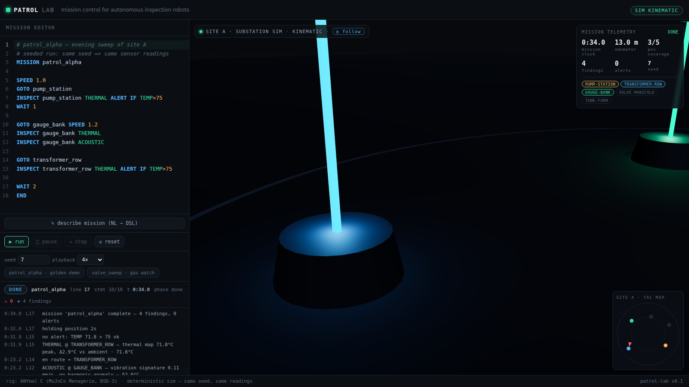

# patrol-lab

**Mission control for autonomous inspection robots** — write a mission script on the
left, watch an ANYmal C quadruped execute it on a live 3D industrial site on the right.
Every alert, ETA and coverage number on the dashboard comes from the running
simulation — deterministic, seeded, reproducible.

**Live:** https://patrol-lab.ricothen.com (also at https://patrol-lab.vercel.app)



> Independent portfolio project. Not affiliated with ANYbotics AG. Robot model:
> [MuJoCo Menagerie](https://github.com/google-deepmind/mujoco_menagerie)
> `anybotics_anymal_c` (BSD-3-Clause).

## The idea

Industrial inspection robots like ANYmal walk plants and substations following mission
plans, streaming thermal/visual/acoustic findings to a control room. patrol-lab
rebuilds that experience end-to-end in the browser:

- **Left:** a mission DSL editor (CodeMirror 6) with line-accurate errors and a
  debugger-style execution view — the line being executed is highlighted while the
  robot acts it out.
- **Right:** a three.js scene of a dark industrial site where the ANYmal C (real MJCF
  rig, real proportions) walks POI-to-POI, inspects, and triggers alerts.
- **Dashboard:** alerts with MTTA, POI coverage per mission, mission timeline, replay.

No GPU server, no robot, no game engine install — physics-faithful geometry, honest
kinematics (labeled as such), 60 fps on an integrated laptop GPU.

## Status

Phases 0–7 shipped (see docs/ROADMAP.md):

- MJCF-faithful ANYmal C rig — the MuJoCo mesh-COM offsets are baked from the
  real model (`scripts/bake_rig.py`); without them every visual geom drifts.
- Mission DSL with line-accurate parser errors; debugger execution: run /
  pause / step / reset, playback 0.5–4×, seeded sensor readings (same seed →
  same findings, reproducible).
- Kinematic trot gait + heading control, honest `KINEMATIC` label.
- **DYNAMICS (BETA)**: one click switches on the real MuJoCo WASM engine
  (official DeepMind bindings) stepping the actual ANYmal C MJCF on a physics
  floor — real contacts, real body sway, physics-derived odometer, fall
  auto-recovery. Gentle heading arcs only (sharp turns + learned policy are
  documented future work, docs/BLUEPRINT.md ADR-02).
- Control-room: telemetry KPI card (clock, odometer, coverage, findings,
  alerts), POI chips, tactical minimap, follow camera, scan FX.
- LLM plugins (optional): NL → mission compiler and grounded inspection
  reports. Without `OPENAI_API_KEY` the endpoints serve rule-based mock
  artifacts labeled `MOCK` / `RULE-BASED` — the app never breaks.
- E2E suite (Playwright): golden mission, parse-error refusal, step mode,
  orientation regression guard, LLM mock flow.

## Development

```bash
npm install
npm run dev        # http://localhost:3000
npm run lint
npm run build
npx playwright test
```

Optional: `OPENAI_API_KEY` enables the NL-to-mission compiler and report writer;
without it the app is fully functional (MOCK_MODE supplies pre-baked outputs).
